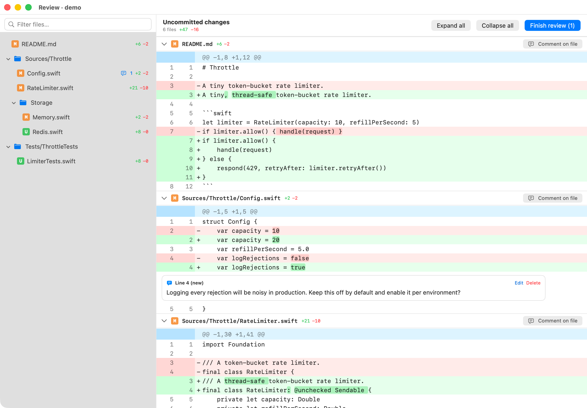

# diffreview

A native macOS tool for reviewing local code changes GitHub-PR style, built to
send that review back to [Claude Code](https://claude.com/claude-code) (or anything
else that reads markdown).

Run `diffreview` in a git repository and a window opens with the diff. Leave inline
comments on lines or ranges, file-level comments and an overall summary, then click
**Submit review**. The review is printed to stdout as markdown and the process exits.



## Requirements

- macOS 14 or later
- Swift 6 toolchain (Xcode or the Command Line Tools)
- `git` on your `PATH`

## Install

```sh
git clone <this repo> diffreview && cd diffreview
swift build -c release
install -m 755 .build/release/diffreview ~/.local/bin/diffreview   # or any directory on your PATH
```

### Updating

After pulling or changing the code, rebuild and reinstall from the repo:

```sh
swift build -c release
install -m 755 .build/release/diffreview ~/.local/bin/diffreview   # same directory as before
```

**diffreview → About diffreview** shows the version and when the running binary was built,
so you can tell whether you're on the latest build.

## Usage

```sh
diffreview                 # uncommitted changes: `git diff HEAD` plus untracked files
diffreview --base main     # commits on the current branch since its merge-base with main
diffreview abc123          # the changes made by one commit (like `git show abc123`)
diffreview abc123..HEAD    # committed changes from abc123 to HEAD (`abc123..` is the same)
diffreview main...feature  # what feature changed since it forked from main
diffreview --session <id>  # Ask Claude chats fork this Claude Code session (see below)
diffreview --help
```

| Result | stdout | exit code |
| --- | --- | --- |
| Submit review | the review as markdown | 0 |
| Close window / quit without submitting | nothing | 1 |
| No changes to review | nothing (message on stderr) | 1 |
| Not a git repository, unknown ref, bad arguments | nothing (message on stderr) | 2 |

`--base` compares committed work only (`merge-base..HEAD`), like a pull request.
Uncommitted changes are not included in that mode.

A commit or range reviews work that's already committed, and never includes
uncommitted changes either. Ranges mean what they mean to `git diff`: `A..B` is the
difference between A and B, and `A...B` is what B changed since its merge-base with A.
To review everything after commit `abc123`, use `abc123..HEAD` (or `abc123..`).

### Reviewing

- **Click a line** to comment on it. **Shift-click** another line in the same file to extend the comment to a range.
- **Drag across code** to comment on just part of it: a few characters, or from the middle of one line to the middle of another.
- **⌘↩** adds the comment, **Esc** cancels. Existing comments can be edited or deleted.
- **Comment on file** (in each file header) adds a file-level comment.
- **Finish review** (⌘⇧↩) opens the summary box and the **Submit review** button.
- Files can be collapsed. Deleted files and files with more than 1,500 changed lines start collapsed.
- The switch in each file header shows the **whole file** instead of its diff, and back. It's the new version: the working tree for uncommitted changes, the file as committed for a commit, range or `--base`. Lines the diff added are marked in the gutter. Comments work the same way in both views, and a comment on a line that only one view shows is listed with the file's comments in the other.
- Code is syntax highlighted in GitHub's colours, for the common languages (by file extension).
- **Settings…** (⌘,) picks the code font (any installed monospaced family, or the system SF Mono) and its size. Its **Chat** tab sets how chats read: typeface, size, line height and a color theme (Standard, Paper, Night, High contrast), with a live preview. Choices are remembered.

### Asking Claude

To ask about code instead of commenting on it, type your question in the comment box and click
**Ask Claude** (⌥⌘↩). This works for line comments and file comments. The question opens a new chat in a sidebar on the
right of the diff, and you can keep asking follow-ups there (⌘↩ sends) without leaving the
review. While a chat is open, the code it's about stays highlighted in the diff.

Every **Ask Claude** starts a chat of its own. With no chat open, the sidebar lists them all;
click one to open it, and click its header to fold it back into the list. **Chats** in the top
bar (⌥⌘C) shows or hides the sidebar at any time, and the box at the bottom of the list asks
about the diff as a whole.

Chats run `claude -p` (Claude Code in headless mode) in the repository, so they need `claude`
on your `PATH` (or in `~/.local/bin`) and use your Claude Code login. They can only read: the
Read, Grep and Glob tools, plus `git log`, `git show` and `git diff`. MCP servers and connectors
are left out.

When the review was opened by `/diffreview`, each chat starts as a fork of that Claude Code
session (`--resume <id> --fork-session`), so it answers knowing what that session knows about
the code: why it was written that way, what was tried. The session itself isn't changed, and
nothing from the chats goes into it. Run `diffreview` yourself and chats start as new sessions,
which can read the code but don't know its history. Pass `--session <id>` to fork a session of
your choice.

Chats aren't part of the review and aren't saved: they end when the window closes. Each
`claude` run is logged to `.git/diffreview/chats.log` (its arguments, exit status, stderr and
the output that isn't answer text), which is where to look if a chat fails.

Drafts are saved automatically to `.git/diffreview/comments.json`, so closing the
window doesn't lose work: the next run picks up where you left off. The file is
deleted when you submit. If you close the window while a comment is still being
typed, that text is kept as a comment.

### Output format

````markdown
# Code Review

Overall summary.

## path/to/file.swift

A file-level comment.

### Lines 42-45 (new)

```swift
let the = "selected lines"
```

The comment.
````

When only part of the lines was selected, the full lines are still shown for context,
followed by a `Selected text:` block with the exact selection.

Line numbers refer to the new version of the file, or to the old version (`(old)`)
when only deleted lines are selected. Selections that mix added and removed lines
are shown as a `diff` block.

When the review is of committed work (a commit, a range or `--base`), a line under the
title says which commits it covers, so the reader can find them even after HEAD moves:

```markdown
Reviewing commit 170ec1b ("Set the Dock icon"). Line numbers marked (new) are from 170ec1b, (old) from its parent.
Reviewing 80e8115..170ec1b (3 commits). Line numbers marked (new) are from 170ec1b, (old) from 80e8115.
```

## Claude Code integration

The repo ships a `/diffreview` command in
[`.claude/commands/diffreview.md`](.claude/commands/diffreview.md). Install it for all your
projects:

```sh
mkdir -p ~/.claude/commands
cp .claude/commands/diffreview.md ~/.claude/commands/
```

It contains:

```markdown
---
description: Open diffreview to review changes GitHub-style, then address the comments
argument-hint: [--base <ref> | <commit> | <range>]
allowed-tools: Bash(diffreview) Bash(diffreview *)
---
!`diffreview --session="${CLAUDE_SESSION_ID}" $ARGUMENTS`
Address each review comment above. If something is unclear, ask before changing it.
```

Then run `/diffreview` (or `/diffreview --base main`) in any repository. Cancelling the
review makes the command abort, so nothing is sent to Claude. `--session` hands diffreview the
session's id, so [Ask Claude](#asking-claude) chats can fork it.

**Timeout:** Claude Code runs `!` commands under the Bash tool's default timeout of
2 minutes, and reviews usually take longer. Raise it in `~/.claude/settings.json`:

```json
{
  "env": {
    "BASH_DEFAULT_TIMEOUT_MS": "3600000",
    "BASH_MAX_TIMEOUT_MS": "3600000"
  }
}
```

This also changes the default timeout for every other Bash command Claude Code runs.

## Development

```sh
swift build
scripts/test.sh
```

Use `scripts/test.sh` rather than `swift test`. With only the Command Line Tools
installed (no Xcode), `swift test` builds the swift-testing tests but runs none of
them and still reports success. The script detects that setup and runs the tests
through a small runner (`scripts/TestRunner.swift`). Under Xcode it just calls `swift test`.

### Layout

- `Sources/DiffReviewCore`: no UI. Runs git, parses unified diffs (renames, copies,
  binary files, mode changes, quoted paths, "\ No newline at end of file"), models
  comments, renders the markdown review and stores drafts. `Syntax.swift` and
  `Grammar.swift` are the syntax highlighter: a small line-by-line tokenizer, with no
  dependencies, that carries block comments and multi-line strings from line to line.
- `Sources/diffreview`: the AppKit/SwiftUI app.
- `Tests/DiffReviewCoreTests`: parser and renderer tests, plus integration tests that
  run real git in temporary repositories.

## License

[MIT](LICENSE)
