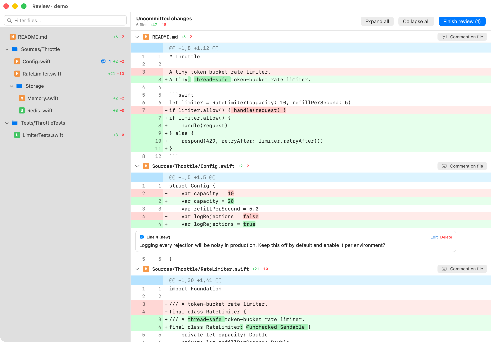

# diffreview

A native macOS tool for reviewing local code changes GitHub-PR style, built to
send that review back to [Claude Code](https://claude.com/claude-code) (or anything
else that reads markdown).

Run `diffreview` in a git repository and a window opens with the diff. Leave inline
comments on lines or ranges, file-level comments and an overall summary, then click
**Submit review**. The review is printed to stdout as markdown and the process exits.



## Requirements

- macOS 14 or later
- Swift 6 toolchain (Xcode or the Command Line Tools)
- `git` on your `PATH`

## Install

```sh
git clone <this repo> diffreview && cd diffreview
swift build -c release
install -m 755 .build/release/diffreview ~/.local/bin/diffreview   # or any directory on your PATH
```

### Updating

After pulling or changing the code, rebuild and reinstall from the repo:

```sh
swift build -c release
install -m 755 .build/release/diffreview ~/.local/bin/diffreview   # same directory as before
```

## Usage

```sh
diffreview                 # uncommitted changes: `git diff HEAD` plus untracked files
diffreview --base main     # commits on the current branch since its merge-base with main
diffreview --help
```

| Result | stdout | exit code |
| --- | --- | --- |
| Submit review | the review as markdown | 0 |
| Close window / quit without submitting | nothing | 1 |
| No changes to review | nothing (message on stderr) | 1 |
| Not a git repository, unknown ref, bad arguments | nothing (message on stderr) | 2 |

`--base` compares committed work only (`merge-base..HEAD`), like a pull request.
Uncommitted changes are not included in that mode.

### Reviewing

- **Click a line** to comment on it. **Shift-click** another line in the same file to extend the comment to a range.
- **Drag across code** to comment on just part of it: a few characters, or from the middle of one line to the middle of another.
- **⌘↩** adds the comment, **Esc** cancels. Existing comments can be edited or deleted.
- **Comment on file** (in each file header) adds a file-level comment.
- **Finish review** (⌘⇧↩) opens the summary box and the **Submit review** button.
- Files can be collapsed. Files with more than 1,500 changed lines start collapsed.
- **Settings…** (⌘,) picks the code font (any installed monospaced family, or the system SF Mono) and its size. The choice is remembered.

Drafts are saved automatically to `.git/diffreview/comments.json`, so closing the
window doesn't lose work: the next run picks up where you left off. The file is
deleted when you submit. If you close the window while a comment is still being
typed, that text is kept as a comment.

### Output format

````markdown
# Code Review

Overall summary.

## path/to/file.swift

A file-level comment.

### Lines 42-45 (new)

```swift
let the = "selected lines"
```

The comment.
````

When only part of the lines was selected, the full lines are still shown for context,
followed by a `Selected text:` block with the exact selection.

Line numbers refer to the new version of the file, or to the old version (`(old)`)
when only deleted lines are selected. Selections that mix added and removed lines
are shown as a `diff` block.

## Claude Code integration

The repo ships a `/diffreview` command in
[`.claude/commands/diffreview.md`](.claude/commands/diffreview.md). Install it for all your
projects:

```sh
mkdir -p ~/.claude/commands
cp .claude/commands/diffreview.md ~/.claude/commands/
```

It contains:

```markdown
---
description: Open diffreview to review changes GitHub-style, then address the comments
argument-hint: [--base <ref>]
allowed-tools: Bash(diffreview) Bash(diffreview *)
---
!`diffreview $ARGUMENTS`
Address each review comment above. If something is unclear, ask before changing it.
```

Then run `/diffreview` (or `/diffreview --base main`) in any repository. Cancelling the
review makes the command abort, so nothing is sent to Claude.

**Timeout:** Claude Code runs `!` commands under the Bash tool's default timeout of
2 minutes, and reviews usually take longer. Raise it in `~/.claude/settings.json`:

```json
{
  "env": {
    "BASH_DEFAULT_TIMEOUT_MS": "3600000",
    "BASH_MAX_TIMEOUT_MS": "3600000"
  }
}
```

This also changes the default timeout for every other Bash command Claude Code runs.

## Development

```sh
swift build
scripts/test.sh
```

Use `scripts/test.sh` rather than `swift test`. With only the Command Line Tools
installed (no Xcode), `swift test` builds the swift-testing tests but runs none of
them and still reports success. The script detects that setup and runs the tests
through a small runner (`scripts/TestRunner.swift`). Under Xcode it just calls `swift test`.

### Layout

- `Sources/DiffReviewCore`: no UI. Runs git, parses unified diffs (renames, copies,
  binary files, mode changes, quoted paths, "\ No newline at end of file"), models
  comments, renders the markdown review and stores drafts.
- `Sources/diffreview`: the AppKit/SwiftUI app.
- `Tests/DiffReviewCoreTests`: parser and renderer tests, plus integration tests that
  run real git in temporary repositories.

Syntax highlighting isn't implemented yet. `Sources/diffreview/SyntaxHighlighter.swift`
is the place to add it: each line is passed through `SyntaxHighlighter.highlight(_:language:)`.

## License

[MIT](LICENSE)
